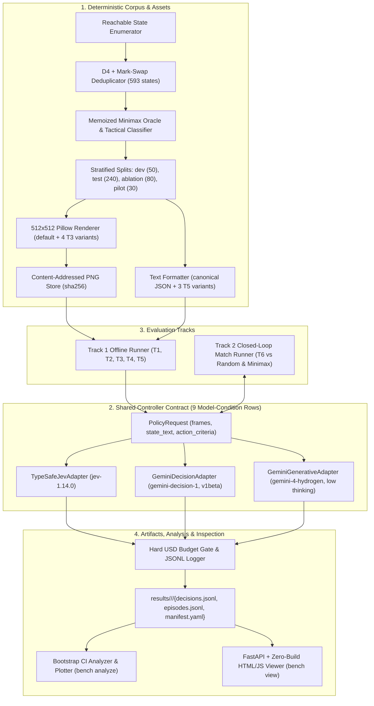

# Tic-Tac-Toe MVP — End-to-End Implementation Plan

**Project:** `systemone` (`dm-bench`)  
**Scope:** Milestone 0 (API Feasibility & Smoke Test) + Full Milestone 1 (`T1`–`T6`, Statistical Analysis, Plots, and FastAPI Trace Viewer)  
**Companion Spec:** [RESEARCH_PLAN.md](file:///Users/abhinand/Desktop/Misc/systemone/RESEARCH_PLAN.md) (v0.2 locked decisions)

---

## 1. System Architecture & Data Flow



---

## 2. Repository & Package Layout

```text
systemone/
├── README.md
├── RESEARCH_PLAN.md
├── IMPLEMENTATION_PLAN.md
├── pyproject.toml
├── .env.example
├── .gitignore
├── experiments/
│   ├── configs/
│   │   ├── models/
│   │   │   ├── jev_1_14_0.yaml
│   │   │   ├── gemini_decision_1.yaml
│   │   │   └── gemini_4_hydrogen.yaml
│   │   ├── games/
│   │   │   └── tic_tac_toe.yaml
│   │   └── conditions/
│   │       └── core_matrix.yaml
│   ├── prompts/
│   │   └── tic_tac_toe_v1.yaml
│   ├── datasets/
│   │   ├── dev/
│   │   │   └── ttt_dev_50.jsonl
│   │   └── test/
│   │       ├── ttt_test_240.jsonl
│   │       ├── ttt_ablation_80.jsonl
│   │       └── ttt_pilot_30.jsonl
│   ├── results/
│   │   └── .gitkeep
│   └── media/
│       └── .gitkeep
├── src/
│   └── dm_bench/
│       ├── __init__.py
│       ├── cli.py                        # `bench` entrypoint: check-env, build-corpus, smoke, eval, analyze, view
│       ├── config.py                     # YAML config loaders, pricing calculator, thread-safe BudgetTracker
│       ├── contracts.py                  # Pydantic schemas: PolicyRequest/Result, DecisionLogRow, EpisodeLogRow, RunManifest
│       ├── logging_io.py                 # sha256 MediaStore, streaming JSONL logger, manifest writer, resume index
│       ├── smoke.py                      # Milestone 0 contract verification + 10 cold/warm latency benchmark
│       ├── games/
│       │   ├── __init__.py
│       │   └── tic_tac_toe/
│       │       ├── __init__.py
│       │       ├── engine.py             # 3x3 rules, R1C1..R3C3 keys, D4 symmetries, all_9 vs legal_only, forfeit step
│       │       ├── oracle.py             # Exact memoized minimax solver, regret math, 6-way tactical classifier
│       │       ├── renderer.py           # 512x512 PNG Pillow renderer (clean_default + 4 T3 perturbations)
│       │       ├── formats.py            # 4 T5 text serializers (json_canonical, ascii_grid, coord_list, json_with_history)
│       │       └── corpus.py             # Deterministic state enumeration, symmetry deduplication, stratified splitter
│       ├── adapters/
│       │   ├── __init__.py
│       │   ├── base.py                   # PolicyAdapter, DecisionModelAdapter, GenerativeAdapter, Mock adapters
│       │   ├── retry.py                  # Transient 429/5xx exponential backoff wrapper (0 retries on malformed output)
│       │   ├── typesafe_jev.py           # AsyncTypeSafeClient + Choice + Image + Danger-Zone header
│       │   ├── gemini_decision.py        # google-genai v1beta client.aio.decisions.create
│       │   ├── gemini_generative.py      # google-genai v1 client.aio.interactions.create (thinking_level="low")
│       │   └── factory.py                # Instantiates the 9 condition rows (live or --mock)
│       ├── runners/
│       │   ├── __init__.py
│       │   ├── offline.py                # Track 1 async runner for T1, T2, T3, T4, T5 with checkpoint resume
│       │   └── matches.py                # Track 2 closed-loop step-paused match runner for T6 (vs random & minimax)
│       ├── analysis/
│       │   ├── __init__.py
│       │   ├── stats.py                  # Paired 95% bootstrap CIs, McNemar test, multi-optimal calibration metrics
│       │   ├── plots.py                  # Matplotlib publication charts (T1-T6, latency CDF, Pareto, reliability)
│       │   └── report.py                 # Markdown summary tables + Milestone 1 interim memo generator
│       └── viewer/
│           ├── __init__.py
│           ├── app.py                    # FastAPI JSON endpoints + static media serving
│           └── static/
│               └── index.html            # Zero-build single-page trace inspector & T6 episode scrubber
└── tests/
    ├── test_ttt_engine_oracle.py
    ├── test_ttt_renderer_formats.py
    ├── test_ttt_corpus.py
    ├── test_adapters_and_retry.py
    ├── test_runners_and_resume.py
    └── test_analysis_and_viewer.py
```

---

## 3. Environment, Dependencies & Verified SDK Details

### 3.1 `pyproject.toml` Dependencies
Target **Python `>=3.12`** inside `.venv`:
- **SDKs:** `typesafe-sdk[pil]>=0.7.5`, `google-genai>=3.3.0`
- **Core:** `pydantic>=2.7.0`, `pyyaml>=6.0.1`, `python-dotenv>=1.0.1`, `pillow>=10.3.0`, `rich>=13.7.0`
- **Analysis & Plots:** `numpy>=1.26.0`, `matplotlib>=3.9.0`
- **Trace Viewer:** `fastapi>=0.111.0`, `uvicorn>=0.30.0`, `httpx>=0.27.0` (for FastAPI `TestClient`)
- **Dev/Test:** `pytest>=8.2.0`, `pytest-asyncio>=0.23.0`
- **CLI Entrypoint:** `bench = "dm_bench.cli:main"`

### 3.2 Critical Verified SDK Implementation Rules

> [!IMPORTANT]
> The rules below were verified directly against `typesafe-sdk 0.7.5` and `google-genai 3.3.0` and prevent immediate runtime errors.

1. **TypeSafe Jev (`jev-1.14.0` via `typesafe_sdk`):**
   - Use `AsyncTypeSafeClient(api_key=...)` and call `await client.system_one(state=..., questions={"action": Choice(instructions=..., criteria=...)}, model="jev-1.14.0", extra_headers=...)`.
   - **Image header gotcha:** `typesafe-sdk 0.7.5` serializes `typesafe_sdk.Image(png_bytes)` as multipart assets automatically, **but does not inject `TypeSafe-Danger-Zone-Images: true`**. Whenever `request.frames` is non-empty, explicitly pass `extra_headers={"TypeSafe-Danger-Zone-Images": "true"}`.
   - **State payload shape:**
     - `DM-V` (`A_jev_V`): `state={"board_image": Image(frame.png_bytes)}`
     - `DM-T` (`B_jev_T`): `state={"game_state": request.state_text}`
     - `DM-VT` (`D_jev_VT`): `state={"board_image": Image(frame.png_bytes), "game_state": request.state_text}`
   - **Response parsing:** Read `ans = response.answers["action"]` (`ChoiceAnswer`, *not* `response.choices`), extracting `ans.choice: str`, `ans.probabilities: dict[str, float]`, `ans.confidence: float`, and `response.usage.input_tokens` / `response.usage.output_tokens`.
   - **Pricing:** `\$0.042` / 1M input tokens, `\$0.00` / 1M output tokens.

2. **Google Gemini Decision 1 (`gemini-decision-1` via `google-genai`):**
   - **API version gotcha:** `decisions.create` is `v1beta`-only (`google-genai >= 3.0` defaults to `v1`). Initialize `genai.Client(api_key=..., http_options={"api_version": "v1beta"})`.
   - Call `await client.aio.decisions.create(model="gemini-decision-1", input=input_blocks, questions={"action": {"type": "choice", "instructions": request.objective_instructions, "criteria": request.action_criteria}})`.
   - **Input payload shape:** Uses the shared multimodal block list:
     - Image block: `{"type": "image", "data": base64.b64encode(frame.png_bytes).decode("ascii"), "mime_type": "image/png"}`
     - Text block: `{"type": "text", "text": request.state_text}`
   - **Response parsing:** Read `ans = response.answers["action"]` (`ans.choice`, `ans.probabilities`, `ans.confidence`) and `response.usage` (`total_input_tokens`, `total_output_tokens`, `total_thought_tokens`, `total_tokens`).
   - **Pricing:** `\$0.10` / 1M input tokens, `\$0.00` / 1M output tokens.

3. **Google Gemini 4 Hydrogen (`gemini-4-hydrogen` via `google-genai` Interactions API):**
   - Initialize `genai.Client(api_key=..., http_options={"api_version": "v1"})`.
   - **Deprecated parameter gotchas:**
     - Do **not** pass `temperature`, `top_p`, `top_k`, or top-level `response_mime_type` (removed on Gemini 4 Interactions API).
     - Do **not** pass `thinking_level="minimal"` (unsupported on `gemini-4-hydrogen`; valid values are `"low"`, `"medium"`, `"high"`, `"xhigh"`).
     - Do **not** set a small `max_output_tokens` (it budgets thought + output tokens together and truncates with `status="incomplete"`). Leave `max_output_tokens` unset (`65,536` default) and pin `generation_config={"thinking_level": "low"}`.
   - **Structured output schema:**
     ```python
     response_format = {
         "type": "text",
         "mime_type": "application/json",
         "schema": {
             "type": "object",
             "properties": {
                 "action": {
                     "type": "string",
                     "enum": list(request.action_criteria.keys()),
                 }
             },
             "required": ["action"],
             "additionalProperties": False,
         },
     }
     ```
   - Set `store=False` so benchmark calls do not accumulate server-side stored interactions.
   - **Prompt parity rule:** Construct `system_instruction` using the **exact same `objective_instructions` and `action_criteria` key-description list** given to the Decision Models, instructing the model to output JSON matching the schema with no commentary.
   - **Billing token formula:** Compute non-input billable tokens as `max(0, usage.total_tokens - usage.total_input_tokens)` when both fields are populated (falling back to `(usage.total_output_tokens or 0) + (usage.total_thought_tokens or 0)`), preventing any double-counting between `total_output_tokens` and `total_thought_tokens`.
   - **Pricing:** `\$1.50` / 1M input tokens, `\$7.50` / 1M non-input (`output + thought`) tokens.

---

## 4. Experimental Matrix & Configuration Schemas

### 4.1 Nine Model-Condition Rows (`experiments/configs/conditions/core_matrix.yaml`)

| `row_id` | `condition_code` | `model_key` | Vision (`frames`) | Text (`state_text`) | Family |
|---|---|---|---|---|---|
| `A_jev_V` | `A-DM-V` | `jev_1_14_0` | Yes | No | Decision Model |
| `B_jev_T` | `B-DM-T` | `jev_1_14_0` | No | Yes | Decision Model |
| `D_jev_VT` | `D-DM-VT` | `jev_1_14_0` | Yes | Yes | Decision Model |
| `A_gdec_V` | `A-DM-V` | `gemini_decision_1` | Yes | No | Decision Model |
| `B_gdec_T` | `B-DM-T` | `gemini_decision_1` | No | Yes | Decision Model |
| `D_gdec_VT` | `D-DM-VT` | `gemini_decision_1` | Yes | Yes | Decision Model |
| `C_ghyd_V` | `C-VLM-V` | `gemini_4_hydrogen` | Yes | No | Generative VLM |
| `E_ghyd_VT` | `E-VLM-VT` | `gemini_4_hydrogen` | Yes | Yes | Generative VLM |
| `F_ghyd_T` | `F-LLM-T` | `gemini_4_hydrogen` | No | Yes | Generative LLM |

### 4.2 Shared Action Criteria (`experiments/prompts/tic_tac_toe_v1.yaml`)
All 9 rows use row-major cell keys `R1C1`..`R3C3`:
- `R1C1`: `"Top-left cell (row 1, column 1)"`
- `R1C2`: `"Top-center cell (row 1, column 2)"`
- `R1C3`: `"Top-right cell (row 1, column 3)"`
- `R2C1`: `"Middle-left cell (row 2, column 1)"`
- `R2C2`: `"Center cell (row 2, column 2)"`
- `R2C3`: `"Middle-right cell (row 2, column 3)"`
- `R3C1`: `"Bottom-left cell (row 3, column 1)"`
- `R3C2`: `"Bottom-center cell (row 3, column 2)"`
- `R3C3`: `"Bottom-right cell (row 3, column 3)"`

In `all_9` mode (default), all 9 keys are passed in deterministic order `R1C1..R3C3`. In `legal_only` mode (`T4` and the `T6` pure-strategy slice), `action_criteria` is filtered to `{k: desc for k, desc in FULL_CRITERIA.items() if k in legal_actions}` preserving `R1C1..R3C3` order.

### 4.3 Retry & Error Accounting (`adapters/retry.py`)
- **Transient API/network errors** (`429` rate limit, `500`/`502`/`503`/`504`, socket timeouts): Retry up to `max_retries=3` with exponential backoff (`1.0s`, `2.0s`, `4.0s` + jitter). Increment `retries` on `PolicyResult` and include retry wait in `end_to_end_latency_ms` while recording the final successful call's `model_latency_ms`. If all retries fail, record `response_valid=False`, `error_type=<ExceptionClass>`, `requested_action=None` (do not crash the batch).
- **Malformed output / schema mismatch / safety block / illegal square**: **Zero retries.** Record `response_valid=False` (or `action_is_legal=False`) immediately so model contract failures are never hidden.
- **Hard USD spend cap (`BudgetTracker`)**: Checked *before* dispatching each call and updated *immediately after* receiving token usage. Default cap: `\$10.00` per CLI run (`\$1.00` for `bench smoke`), configurable via `--max-cost-usd`. Exceeding the cap flushes logs, marks `manifest.yaml` with `status: halted_budget_cap`, and exits cleanly.

---

## 5. Tic-Tac-Toe Engine, Oracle, Renderer, Formatters & Corpus

### 5.1 Deterministic Engine (`games/tic_tac_toe/engine.py`)
- **State:** `TTTState(board: tuple[str, ...], player_to_move: Literal["X", "O"], move_history: tuple[int, ...], starting_player: Literal["X", "O"])` where `board` has length 9 with values in `{"X", "O", "."}`.
- **D4 Dihedral Symmetries:** Implement all 8 spatial index transforms (`0`: identity, `1`: 90° CW, `2`: 180°, `3`: 270° CW, `4`: horizontal flip, `5`: vertical flip, `6`: main-diagonal transpose, `7`: anti-diagonal transpose) as forward maps `old_idx -> new_idx` applied identically to `board` and `move_history`.
- **Closed-Loop Step (`step_ttt`):**
  - If `action_key` is `None`, not in `CELL_KEYS`, or `board[idx] != "."`: return `StepOutcome(next_state=state, reward=-1.0, done=True, action_is_legal=False, winner=other_mark(player_to_move), termination_reason="illegal_forfeit")`.
  - Otherwise place `player_to_move` at `idx`, append `idx` to `move_history`, check 8 winning lines (`termination_reason="win"`, `reward=1.0`), full board (`termination_reason="draw"`, `reward=0.0`), or non-terminal (`reward=0.0`, `done=False`).

### 5.2 Exact Minimax Oracle & Tactical Classifier (`games/tic_tac_toe/oracle.py`)
- Memoized recursive `minimax_value(board, player_to_move) -> int` returning `+1` (forced win for `player_to_move`), `0` (draw), or `-1` (loss against optimal play).
- For any non-terminal state, compute `action_values: dict[str, int]` over all legal cells, `state_value = max(action_values.values())`, and `optimal_actions = tuple(k for k, v in action_values.items() if v == state_value)`.
- **Regret tracking:**
  - `legal_regret`: `state_value - action_values[a]` when `a` is legal (`0`, `1`, or `2`), else `None`.
  - `effective_regret` (`minimax_regret`): `state_value - action_values[a]` when `a` is legal, else `state_value - (-1)` (reflecting immediate forfeit value `-1`). Reporting both separates strategic suboptimal regret from illegal-move penalties.
- **Six mutually-exclusive tactical categories** (evaluated in priority order):
  1. `immediate_win`: `player_to_move` has $\ge 1$ move creating 3-in-a-row immediately (298 canonical states).
  2. `losing_position`: No immediate win, and `state_value == -1` because opponent already holds an unstoppable double threat (89 canonical states).
  3. `forced_block`: Not above, `state_value >= 0`, and opponent would have $\ge 1$ immediate 1-move win if unblocked (111 canonical states).
  4. `fork_create`: Not above, and `state_value == +1` — `player_to_move` can force a win via fork creation (37 canonical states).
  5. `fork_defend`: Not above, `state_value == 0`, and $\min(\text{action\_values}) == -1$ — requires strategic defense/opening play to avoid walking into an opponent fork (32 canonical states).
  6. `forced_draw`: `state_value == 0` and every legal move yields `0` (26 canonical states).

### 5.3 Deterministic Corpus Generation (`games/tic_tac_toe/corpus.py`)
- BFS from empty board (`starting_player="X"`) enumerates all reachable non-terminal states with `>= 2` empty squares (excluding trivial 1-empty-cell ply-8 states where any legal action has zero strategic choice) and deduplicates modulo D4 symmetry + mark normalization (`canonical_d4_key`), yielding **593 canonical states**.
- Using fixed seed `20261114`:
  1. Apply a deterministic random D4 symmetry `sym_id in 0..7` to each canonical state so rendered screenshots have unbiased spatial orientation.
  2. Flip marks (`X <-> O`, including `starting_player` and `player_to_move`) on exactly half of states within each category so `player_to_move == "X"` and `player_to_move == "O"` are balanced 50/50 across every category (preventing models from inferring turn purely by piece count without reading `"Player to move"`).
  3. Stratified split with zero canonical-key overlap between `dev` and `test`:
     - **`ttt_dev_50.jsonl` (50 states):** Stratified across all 6 categories (`immediate_win`: 18, `forced_block`: 10, `losing_position`: 7, `fork_create`: 5, `fork_defend`: 5, `forced_draw`: 5).
     - **`ttt_test_240.jsonl` (240 held-out states):** Stratified with boosted representation of scarce strategic categories while preserving all category slices (`immediate_win`: 90, `forced_block`: 50, `losing_position`: 30, `fork_create`: 28, `fork_defend`: 24, `forced_draw`: 18 — every number fits inside `593 - 50`!).
     - **`ttt_ablation_80.jsonl` (80 states):** Stratified subset of `ttt_test_240.jsonl` (`immediate_win`: 28, `forced_block`: 18, `losing_position`: 10, `fork_create`: 10, `fork_defend`: 8, `forced_draw`: 6) used by default for `T3` and `T5` (paired directly against those same 80 states in `T2`!).
     - **`ttt_pilot_30.jsonl` (30 states):** Stratified 5-per-category subset of `ttt_test_240.jsonl` for `--pilot`.
- Each JSONL record stores: `position_id`, `canonical_hash`, `board`, `player_to_move`, `starting_player`, `move_history`, `ply`, `d4_sym_id`, `state_value`, `optimal_actions`, `action_values`, and `tactical_category`.

### 5.4 Pillow 512×512 PNG Renderer (`games/tic_tac_toe/renderer.py`)
All screenshots render at **`512 × 512` RGB PNG** (well inside TypeSafe Jev's `280–1568 px` requirement):
- Top banner (`y = 0..76`): crisp centered text `"Player to move: X"` (or `"Player to move: O"`).
- Board region (`x = 56..456`, `y = 92..492`, cell size `133 × 133 px`):
  - **`clean_default`**: `#FAFAFC` background, `#1F2937` `5px` grid lines, geometric anti-aliased vector strokes for `X` (`#1D4ED8` deep blue diagonal cross) and `O` (`#B91C1C` crimson ring), zero cell/margin coordinate text, zero optimal-move cues.
  - **`labeled_margins` (T3.1)**: Identical to `clean_default` plus `C1`, `C2`, `C3` centered above columns and `R1`, `R2`, `R3` centered left of rows in `#4B5563`.
  - **`dark_low_contrast` (T3.2)**: `#1A1D24` background, `#2E3340` `4px` grid lines, muted low-contrast marks (`#4B5263` `X`, `#565E70` `O`) and `#6B7280` turn header.
  - **`thin_alt_font` (T3.3)**: `#FDFBF7` warm paper background, `1px` `#6B7280` hairline grid, font-rendered serif/italic `"X"` and `"O"` characters with deterministic per-cell `±6 px` offset jitter seeded from `(position_id, cell_idx)`.
  - **`tilt_blur` (T3.4)**: Renders `clean_default`, applies deterministic `+5°` or `-5°` rotation (`Image.Resampling.BICUBIC`, fill `#FAFAFC`), followed by `ImageFilter.GaussianBlur(radius=1.4)`.

### 5.5 Text State Formatters (`games/tic_tac_toe/formats.py`)
1. **`json_canonical` (Default):**
   ```json
   {"game": "tic_tac_toe", "board": ["X", ".", "O", ".", "X", ".", ".", ".", "O"], "player_to_move": "X"}
   ```
2. **`ascii_grid` (T5.2):**
   ```text
   Game: tic_tac_toe
   Player to move: X
        C1  C2  C3
   R1 |  X | . | O |
   R2 |  . | X | . |
   R3 |  . | . | O |
   ```
3. **`coord_list` (T5.3):**
   ```text
   Game: tic_tac_toe
   Player to move: X
   Board cells:
   - R1C1: X
   - R1C2: empty
   ...
   - R3C3: O
   ```
4. **`json_with_history` (T5.4):**
   ```json
   {"game": "tic_tac_toe", "board": ["X", ".", "O", ".", "X", ".", ".", ".", "O"], "player_to_move": "X", "move_history": ["R1C1", "R1C3", "R2C2", "R3C3"]}
   ```

---

## 6. Evaluation Runners (Milestone 0 + T1–T6)

### 6.1 Milestone 0 Smoke Runner (`smoke.py` — `bench smoke`)
1. Selects 1 canonical tactical test board (`forced_block` midgame state), renders `clean_default` 512×512 PNG via `MediaStore`, and formats `json_canonical`.
2. Executes 1 contract check call across each of the **9 rows** (`--rows` / `--models` optional filter; `--mock` uses deterministic mock adapters):
   - Verifies `response_valid == True`, `requested_action in CELL_KEYS`, `input_tokens > 0`, `api_cost_usd is not None`.
   - For Decision Models (`jev-1.14.0`, `gemini-decision-1`), asserts `action_probabilities` has all 9 keys, `abs(sum(probs.values()) - 1.0) < 0.02`, and `0.0 <= confidence <= 1.0`.
3. Executes **10 sequential timing calls** (Call 1 = cold, Calls 2–10 = warm; configurable via `--latency-trials 10`) on one representative vision+text request per active model backend (`jev_1_14_0`, `gemini_decision_1`, `gemini_4_hydrogen`), recording cold latency vs warm p50/p95 `model_latency_ms` and `end_to_end_latency_ms`.
4. Writes `experiments/results/M0_smoke/<run_id>/{decisions.jsonl, latency_summary.json, manifest.yaml}` and renders a Rich terminal table.

### 6.2 Track 1 Offline Corpus Runner (`runners/offline.py`)
Supports bounded async concurrency (`--concurrency 4` default) and **automatic checkpoint resume** (`--resume-run-id <run_id>` skips already-logged `(row_id, episode_id, render_variant, text_format, action_mode)` keys):

| Experiment | Dataset (`--pilot` override) | Rows Evaluated | Settings Varied | Total Calls (Full / Pilot) |
|---|---|---|---|---|
| **T1 + T2** (Core Matrix & Tactical Breakdown) | `ttt_test_240.jsonl` (`30`) | All 9 rows (`A..F`) | `clean_default`, `json_canonical`, `all_9` | `2,160` / `270` |
| **T3** (Rendering Robustness) | `ttt_ablation_80.jsonl` (`30`; `--full-240` optional) | Vision-only rows: `A_jev_V`, `A_gdec_V`, `C_ghyd_V` | 4 variants (`labeled_margins`, `dark_low_contrast`, `thin_alt_font`, `tilt_blur`), `all_9` (`clean_default` reused from T2!) | `960` / `360` |
| **T4** (Action-Choice Schema) | `ttt_test_240.jsonl` (`30`) | All 9 rows (`A..F`) | `legal_only` candidate set (`all_9` baseline reused from T2!) | `2,160` / `270` |
| **T5** (Prompt Representation) | `ttt_ablation_80.jsonl` (`30`; `--full-240` optional) | Text-only rows: `B_jev_T`, `B_gdec_T`, `F_ghyd_T` | 3 non-default formats (`ascii_grid`, `coord_list`, `json_with_history`), `all_9` (`json_canonical` reused from T2!) | `720` / `270` |

> [!TIP]
> Notice the zero-waste experimental reuse: `T1` and `T2` share the exact same `2,160`-call core run (`T1` stratifies by tactical category; `T2` compares representations/families), and `T3`/`T4`/`T5` reuse the matching baseline cells from `T2` for paired difference CIs rather than paying twice for identical requests.

### 6.3 Track 2 Closed-Loop Match Runner (`runners/matches.py` — `T6`)
- **Opponents:** `random` (uniform over legal moves using seeded episode `random.Random(episode_seed)`) and `minimax` (uniform over `optimal_actions` using seeded episode `random.Random(episode_seed)` so openings/symmetries diversify reproducibly across seeds while remaining 100% optimal!).
- **Turn balance:** For `N` games per opponent (`100` full, `20` `--pilot`):
  - Games `0 .. N/2 - 1`: Agent plays `"X"` (`starting_player="X"`, moves first); Games `N/2 .. N - 1`: Agent plays `"O"` (`starting_player="X"`, opponent moves first — plus half with `starting_player="O"` so mark identity and turn order are orthogonal!). Specifically, cycle `(agent_mark, goes_first)` evenly across `("X", True)`, `("O", False)`, `("O", True)`, `("X", False)` in blocks of 4!
- **Two modes logged under `T6`:**
  1. **Headline `all_9` mode:** `100` vs `random` + `100` vs `minimax` across all 9 rows (`~4.0` agent turns/game max; illegal move = immediate forfeit `loss_by_illegal_move`).
  2. **Pure-strategy `legal_only` slice:** `50` vs `random` + `50` vs `minimax` (`20` in `--pilot`) across all 9 rows so strategic play is also measured without early forfeit truncation.
- Logs every step to `decisions.jsonl` (saving newly encountered board PNGs via `MediaStore`) and every game outcome to `episodes.jsonl`.

---

## 7. Metrics, Statistical Analysis & Calibration (`analysis/`)

### 7.1 Headline & Secondary Metrics (`stats.py`)
- **Track 1 (Offline):**
  - `optimal_accuracy`: fraction of states where `executed_action in optimal_actions` (unconditional over all states; illegal/invalid = false).
  - `conditional_optimal_accuracy`: optimal accuracy conditioned on `action_is_legal == True`.
  - `illegal_rate`: fraction of states where `response_valid == True` but `action_is_legal == False`.
  - `invalid_response_rate`: fraction of states where `response_valid == False` (API failure / schema parse failure).
  - `mean_effective_regret` & `mean_legal_regret`.
- **Track 2 (Closed-Loop `T6`):**
  - vs `minimax`: **Non-loss rate** (`draws + wins` — since minimax never loses, optimal agent achieves `100%` draw / non-loss rate!), `loss_by_board` rate, `loss_by_illegal_move` rate.
  - vs `random`: **Win rate**, **non-loss rate**, `loss_by_board` rate, `loss_by_illegal_move` rate.
- **Efficiency & Practicality (RQ7):**
  - `model_latency_ms` & `end_to_end_latency_ms` (`p50`, `p95`, `mean`).
  - `cost_per_100_decisions_usd` and `cost_per_episode_usd`.
  - `optimal_decisions_per_usd` (Track 1) and `non_loss_games_per_usd` (Track 2).

### 7.2 Paired Bootstrap CIs & Hypothesis Tests
- For any paired comparison between Row $X$ and Row $Y$ on shared offline state IDs $\{1, \dots, M\}$:
  - Resample state indices with replacement $B = 10{,}000$ times (`rng = np.random.default_rng(20261114)`), computing the 2.5th and 97.5th percentiles of $\Delta = \bar{m}_X - \bar{m}_Y$.
  - Also compute exact two-sided **McNemar p-value** on discordant binary optimal-move pairs $(n_{10}, n_{01})$.

### 7.3 Decision-Model Calibration & Selective Abstention (`jev-1.14.0` & `gemini-decision-1`)
Because Tic-Tac-Toe positions frequently have $|\mathcal{A}^*(s)| > 1$ equally optimal moves (where a perfectly calibrated model splits probability mass across multiple optimal squares, e.g., `0.50` + `0.50`), we compute **three complementary calibration views** on `T2` (`all_9`):
1. **Chosen-action reliability (Top-1 $P(\hat{a} \mid s)$ & reported `confidence`):** Bin predictions into 10 equal-count / fixed-width bins against $\mathbb{I}[\hat{a} \in \mathcal{A}^*(s)]$; compute ECE and Brier score.
2. **Optimal-set probability mass:** $P(\mathcal{A}^* \mid s) = \sum_{a \in \mathcal{A}^*(s)} P(a \mid s)$, representing the model's exact probability of sampling an optimal move, alongside **illegal probability mass** $P(\mathcal{A}_{\text{occupied}} \mid s) = \sum_{a \notin \mathcal{A}_{\text{legal}}(s)} P(a \mid s)$.
3. **Selective decision coverage curve (Section 9):** Sweep abstention threshold $\tau \in [0, 1]$ on `confidence` (and $P(\hat{a} \mid s)$), plotting optimal-move accuracy on retained states vs coverage fraction (plus simulated hybrid fallback cost/accuracy when abstaining to `minimax` or `gemini-4-hydrogen`).

### 7.4 Automated Plots & Report (`bench analyze`)
Generates PNG + SVG charts in `analysis/plots/<tag>/` and a structured Markdown report (`analysis/reports/<tag>_summary.md`):
1. `t2_core_accuracy_illegal.png` — Grouped bar chart of Optimal Accuracy & Illegal Rate across all 9 rows with 95% CIs.
2. `t1_tactical_heatmap.png` — 9 rows × 6 tactical categories optimal-move accuracy heatmap.
3. `t3_rendering_robustness.png` — Accuracy across `clean_default` + 4 visual perturbations (`A_jev_V`, `A_gdec_V`, `C_ghyd_V`).
4. `t4_legality_schema_delta.png` — Paired `all_9` vs `legal_only` accuracy comparison.
5. `t5_prompt_formats.png` — Accuracy across the 4 text representations (`B_jev_T`, `B_gdec_T`, `F_ghyd_T`).
6. `t6_match_outcomes.png` — Stacked bar chart (`win`, `draw`, `loss_by_board`, `loss_by_illegal_move`) vs Random and vs Minimax.
7. `latency_cdf.png` — Empirical CDF of `end_to_end_latency_ms` by row (`p50` / `p95` markers).
8. `pareto_quality_vs_cost.png` — Optimal accuracy vs USD per 100 decisions with Pareto frontier highlighted.
9. `dm_calibration_and_abstention.png` — Reliability diagram + Accuracy-vs-Coverage abstention curve for `jev-1.14.0` and `gemini-decision-1`.

---

## 8. Trace Viewer Specification (`viewer/` — `bench view`)

Launched via `.venv/bin/bench view --port 8000`:

### 8.1 FastAPI Backend (`viewer/app.py`)
- `GET /` → Serves `static/index.html`.
- `GET /media/frames/{filename}` → Serves cached PNGs from `experiments/media/frames/`.
- `GET /api/runs` → Lists all discovered `(experiment_id, run_id)` folders with manifest metadata (`status`, `total_decisions`, `total_spent_usd`, `created_at_utc`).
- `GET /api/runs/{experiment_id}/{run_id}/decisions` → Filterable/paginated decisions (`row_id`, `condition`, `tactical_category`, `render_variant`, `text_format`, `only_failures: bool`, `only_illegal: bool`).
- `GET /api/runs/{experiment_id}/{run_id}/matrix/{episode_id}` → Returns all logged rows sharing `episode_id` (e.g., all 9 rows on `pos_0042`) alongside oracle optimal actions & action values for instant side-by-side comparison.
- `GET /api/runs/{experiment_id}/{run_id}/episodes` & `GET /api/runs/{experiment_id}/{run_id}/episodes/{episode_id}` → Lists closed-loop `T6` games and returns ordered step-by-step trace for replay.

### 8.2 Zero-Build Single-Page UI (`viewer/static/index.html`)
- **Tab 1 — Offline Decision Inspector & 9-Way Side-by-Side Matrix:**
  - Filter bar by experiment/run, condition, tactical category, failure type (`Illegal Move`, `Suboptimal Legal`, `API/Schema Error`), and render/text variant.
  - Clicking any position displays the exact **512×512 PNG screenshot**, the exact **text payload**, an **oracle 3×3 value overlay** (`+1`/`0`/`-1` per square), and a **9-card comparison grid** showing each model-condition's chosen cell, legality/optimality badge, latency, cost, and horizontal probability bars (`R1C1..R3C3`) for `jev-1.14.0` and `gemini-decision-1`.
- **Tab 2 — Closed-Loop Episode Scrubber (`T6`):**
  - Filterable list of episodes by opponent (`random` / `minimax`), condition, and outcome (`loss_by_illegal_move`, `loss_by_board`, `draw`, `win`).
  - Interactive step controls (`First`, `Prev`, `Next`, `Last`, keyboard `←`/`→`) updating the board PNG, turn metadata, DM probability distribution at that ply, and final termination reason.

---

## 9. Phased Implementation & Verification Sequence

### Phase 1 — Foundation, TTT Engine/Oracle, Renderer, Formats & Corpus
1. Create `pyproject.toml`, `.env.example`, model/game/matrix/prompt YAMLs, `config.py`, `contracts.py`, and `logging_io.py`.
2. Implement `engine.py`, `oracle.py`, `renderer.py` (`clean_default` + 4 `T3` variants), `formats.py` (4 `T5` formats), and `corpus.py`.
3. Generate and commit deterministic datasets (`ttt_dev_50.jsonl`, `ttt_test_240.jsonl`, `ttt_ablation_80.jsonl`, `ttt_pilot_30.jsonl`).
4. **Verification Gate 1:** Run `pytest tests/test_ttt_*.py`:
   - Minimax empty board value == `0` (all 9 opening moves yield `0`); minimax never loses in 500 self-play / random-play games.
   - D4 symmetry invariance: `minimax_value` and `tactical_category` are invariant across all 8 symmetries and mark swaps.
   - Zero canonical-key intersection between `dev_50` and `test_240`.
   - Every rendered variant produces valid `512×512` PNG bytes within `< 16 MiB` and deterministic `sha256` hashes.

### Phase 2 — Adapters, Budget/Retry Layer & Milestone 0 Smoke Harness
1. Implement `base.py`, `retry.py`, `typesafe_jev.py`, `gemini_decision.py`, `gemini_generative.py`, `factory.py`, `smoke.py`, and `cli.py` (`check-env`, `build-corpus`, `smoke`).
2. **Verification Gate 2a (Offline):** Run `pytest tests/test_adapters_and_retry.py` and `.venv/bin/bench smoke --mock` verifying JSONL/manifest output, `BudgetExceededError` hard stop, `429` retry counter, and 0-retry malformed output logging.
3. **Verification Gate 2b (Live Milestone 0 Gate — Pause for `.env`):**
   - User populates `.env` with `TYPESAFE_API_KEY` and `GEMINI_API_KEY`.
   - Run `.venv/bin/bench smoke` (`--max-cost-usd 1.0`).
   - Confirm all 9 model-condition rows succeed live, inspect cold vs warm p50/p95 latencies and real token costs before launching batch experiments.

### Phase 3 — Track 1 (`T1–T5`) & Track 2 (`T6`) Evaluation Runners
1. Implement `runners/offline.py` (`T1–T5` with baseline reuse & `--resume-run-id`) and `runners/matches.py` (`T6` closed-loop vs `random` & `minimax` in `all_9` and `legal_only` modes).
2. Wire `bench eval` CLI (`bench eval --exp T2 --pilot`, `bench eval --exp all --pilot`, `bench eval --exp T6`, etc.).
3. **Verification Gate 3:** Unit-test checkpoint resume (interrupting after 5 states and resuming produces identical 10-state `decisions.jsonl` with zero duplicate API calls) + run `--mock` across `T1–T6`.

### Phase 4 — Statistical Analysis, Plots & Trace Viewer
1. Implement `analysis/stats.py`, `analysis/plots.py`, and `analysis/report.py` (`bench analyze`).
2. Implement `viewer/app.py` and `viewer/static/index.html` (`bench view`).
3. **Verification Gate 4:** Run `pytest tests/test_analysis_and_viewer.py` (verifying bootstrap CI coverage on synthetic paired data, multi-optimal calibration math, all 9 chart files generated, and FastAPI `TestClient` 200 responses across all viewer endpoints).

### Phase 5 — Live Pilot → Full Milestone 1 Run & Interim Memo
1. Run `.venv/bin/bench eval --exp all --pilot --max-cost-usd 3.0` to validate live end-to-end cost, concurrency, and viewer inspection on real traces.
2. Execute full held-out Milestone 1 suite (`T1/T2`, `T3`, `T4`, `T5`, `T6`) under `--max-cost-usd 10.0` per experiment.
3. Run `.venv/bin/bench analyze` to generate all Milestone 1 plots, tables, representative failure cases, and the 1-page Milestone 1 interim memo.

---

## 10. Estimated API Call & Cost Budget (Full Milestone 1)

| Stage | `jev-1.14.0` Calls | `gemini-decision-1` Calls | `gemini-4-hydrogen` Calls | Est. Total Cost (USD) |
|---|---:|---:|---:|---:|
| **M0 Smoke + 10 Warm/Cold** | 13 | 13 | 13 | `< \$0.05` |
| **T1 + T2** (`240` states × 9 rows) | 720 | 720 | 720 | `~\$1.10` |
| **T3** (`80` states × 4 variants × 3 V-rows) | 320 | 320 | 320 | `~\$0.55` |
| **T4** (`240` states × 9 rows, `legal_only`) | 720 | 720 | 720 | `~\$1.05` |
| **T5** (`80` states × 3 variants × 3 T-rows) | 240 | 240 | 240 | `~\$0.30` |
| **T6** (`200` `all_9` + `100` `legal_only` games × 9 rows, `~3.8` turns/game) | ~3,400 | ~3,400 | ~3,400 | `~\$5.20` |
| **Full Milestone 1 Total** | **~5,413** | **~5,413** | **~5,413** | **`~\$8.25`** |

*(Note: `jev-1.14.0` and `gemini-decision-1` account for `< \$0.60` combined across all `~10,800` DM calls due to zero output tokens and `\$0.042–\$0.10/1M` input pricing; `~93%` of total spend is `gemini-4-hydrogen`.)*
